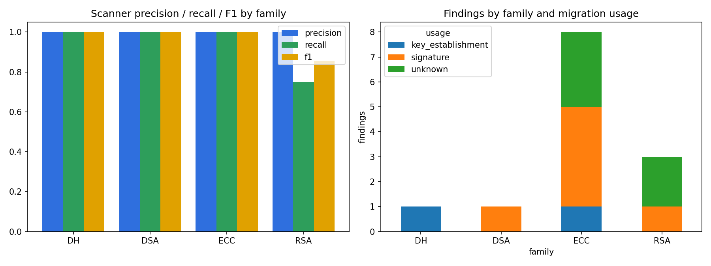
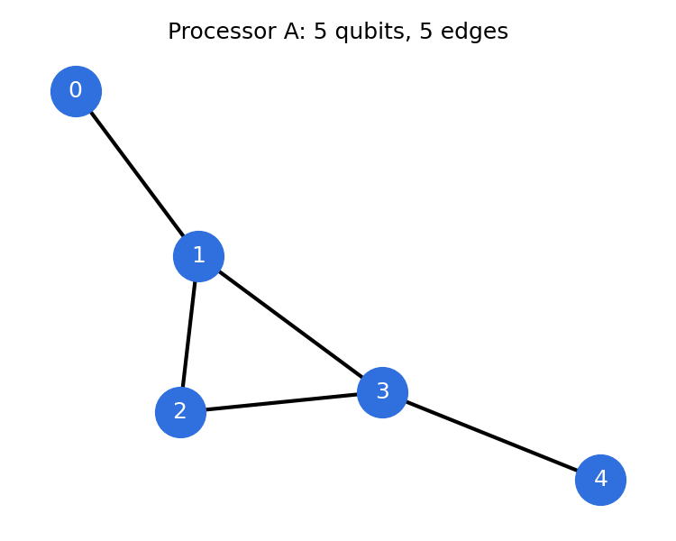
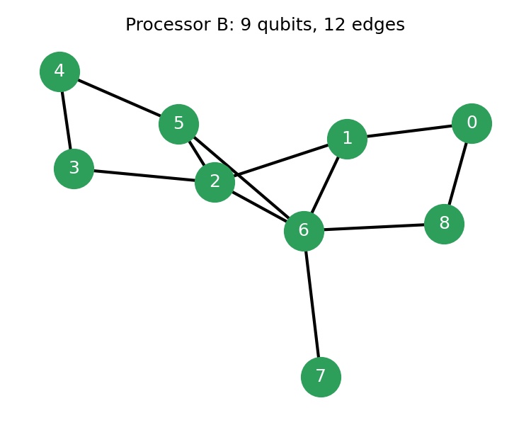
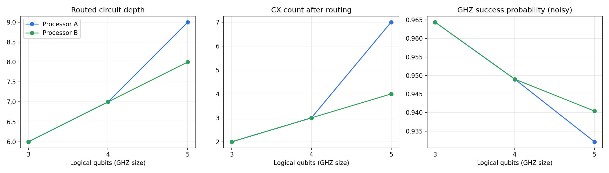
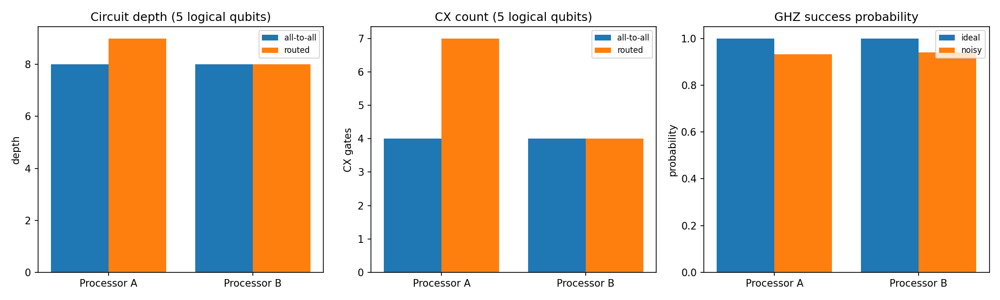

# Phase 1 Report: Cryptographic Inventory & Migration Scanner

_Generated 2026-10-13 23:35 by `python -m src.pipeline`. Every number here is produced by the code in `src/`._

## 1. Problem and domain

Domain: Post-Quantum Cryptography (Quantum-Safe Systems). The scanner flags quantum-vulnerable RSA, DSA, DH and ECC usage in Python source and maps each finding to NIST FIPS 203 (ML-KEM) or FIPS 204 (ML-DSA). The Phase 1 Processor A and B benchmark is reported in section 2.

## 2. Processor A vs Processor B benchmark

Circuit: star-shaped GHZ state (H on qubit 0, then CX from qubit 0 to every other qubit), measured in the computational basis. Exact reference: probability 1/2 each for the all-zeros and all-ones outcomes. Both processors use basis {rz, sx, x, cx}, optimization level 1, seed 42, 4096 shots, and identical synthetic noise (1q depolarizing 0.1%, 2q depolarizing 0.5%, readout 1%).

### 2.1 Headline comparison (5 logical qubits)

| processor | physical_qubits | depth_routed | depth_all_to_all | cx_routed | cx_all_to_all | cx_overhead | swap_est | p_success_ideal | p_success_noisy | hellinger_noisy |
|---|---|---|---|---|---|---|---|---|---|---|
| A | 5 | 9 | 8 | 7 | 4 | 3 | 1 | 1.000 | 0.932 | 0.932 |
| B | 9 | 8 | 8 | 4 | 4 | 0 | 0 | 1.000 | 0.940 | 0.940 |

Column definitions: `cx_overhead` is routed CX minus all-to-all CX; `swap_est` is `cx_overhead / 3`; `p_success` is the probability of the two GHZ outcomes.

### 2.2 Interpretation

Routing the 5-qubit star GHZ circuit needs 7 CX gates on Processor A (depth 9) and 4 on Processor B (depth 8).

Processor B adds fewer routing CX gates than Processor A (0 vs 3, roughly 0 vs 1 SWAPs), so its coupling map suits this circuit better.

Under identical synthetic noise, the GHZ success probability is 0.932 on A and 0.940 on B, against ideal values of 1.000 and 1.000. The drop from ideal to noisy comes from the two-qubit gates in each routed circuit, so the processor with fewer routed CX gates loses less fidelity.

### 2.3 Scaling across GHZ sizes

| processor | logical_qubits | depth_routed | cx_routed | cx_overhead | p_success_noisy | hellinger_noisy |
|---|---|---|---|---|---|---|
| A | 3 | 6 | 2 | 0 | 0.964 | 0.964 |
| A | 4 | 7 | 3 | 0 | 0.949 | 0.949 |
| A | 5 | 9 | 7 | 3 | 0.932 | 0.932 |
| B | 3 | 6 | 2 | 0 | 0.964 | 0.964 |
| B | 4 | 7 | 3 | 0 | 0.949 | 0.949 |
| B | 5 | 8 | 4 | 0 | 0.940 | 0.940 |

## 3. Cryptographic inventory scanner

### 3.1 Accuracy on the labelled fixture corpus

| files | lines | scan_time_s | tp | fp | fn | precision | recall | f1 |
|---|---|---|---|---|---|---|---|---|
| 9 | 146 | 0.003 | 13 | 0 | 1 | 1.000 | 0.929 | 0.963 |

Per family:

| family | tp | fp | fn | precision | recall | f1 |
|---|---|---|---|---|---|---|
| DH | 1 | 0 | 0 | 1.000 | 1.000 | 1.000 |
| DSA | 1 | 0 | 0 | 1.000 | 1.000 | 1.000 |
| ECC | 8 | 0 | 0 | 1.000 | 1.000 | 1.000 |
| RSA | 3 | 0 | 1 | 1.000 | 0.750 | 0.857 |

False negatives (1): `m1_wrapper_miss.py:5` (RSA). The known miss is a call through an internal wrapper library, which the scanner can't resolve without the library source.

False positives (0): none.

### 3.2 Migration plan

Each finding maps to a replacement: key establishment and encryption move to ML-KEM-768 (FIPS 203); signatures move to ML-DSA-65 (FIPS 204). Where usage can't be inferred, both are listed.

| family | usage | replacement | findings |
|---|---|---|---|
| DH | key_establishment | ML-KEM-768 (FIPS 203) | 1 |
| DSA | signature | ML-DSA-65 (FIPS 204) | 1 |
| ECC | key_establishment | ML-KEM-768 (FIPS 203) | 1 |
| ECC | signature | ML-DSA-65 (FIPS 204) | 4 |
| ECC | unknown | ML-KEM-768 (FIPS 203) if used for encryption or key exchange; ML-DSA-65 (FIPS 204) if used for signing | 3 |
| RSA | signature | ML-DSA-65 (FIPS 204) | 1 |
| RSA | unknown | ML-KEM-768 (FIPS 203) if used for encryption or key exchange; ML-DSA-65 (FIPS 204) if used for signing | 2 |

### 3.3 Public repositories

_Skipped in this run (`--skip-repos`)._

## 4. Figures











## 5. Limitations

The labelled corpus is small and was written for this project, so its precision and recall are optimistic compared with a large, independently labelled set. The scanner only looks at Python, resolves calls through direct imports (not wrapper libraries), and guesses usage from names and nearby text, so some findings will be labelled `unknown`. The SWAP count is an estimate derived from CX overhead. Noise is the synthetic model from the problem specification, not a calibrated device model.

## 6. Reproduce

```
pip install -r requirements.txt
python -m src.pipeline
```
Or open `main.ipynb` and run all cells. All stochastic components use seed 42.
