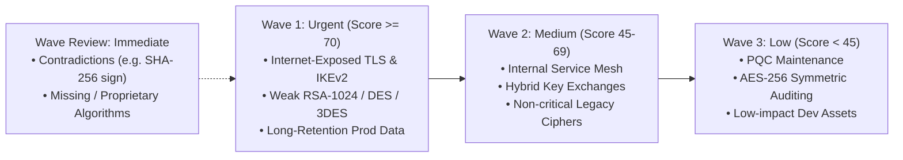

# Technical Report — Team Q-Safe — PS-P2
## Enterprise Cryptographic Inventory and Migration Planner

**Track:** Post-Quantum Cryptography (Quantum-Safe Systems)  
**Problem Statement:** PS-P2 — Enterprise Cryptographic Inventory and Migration Planner  
**Refined with:** Amitabh Development Lab LLP (DPIIT Recognition No. DIPP258164)  
**Execution Environment:** Platform A (Windows 11, Python 3.13.17; see `platform_A_info.json`)  
**Document Date:** October 2026  

---

## Executive Summary

As quantum computing capabilities scale towards cryptographically relevant quantum computers (CRQC), enterprises face severe exposure to Shor's algorithm, which threatens all ubiquitous classical public-key cryptography (RSA, ECDSA, ECDH, Ed25519). However, organizations cannot migrate cryptography they have not located, nor can they treat all cryptographic instances with equal urgency without exhausting operational resources.

This project delivers an offline **Enterprise Cryptographic Inventory and Migration Planning System** aligned with the official **PS-P2 specification** and **NIST Post-Quantum Cryptography standards (FIPS 203, FIPS 204, FIPS 205)**. Evaluated against the official development inventory (`inventory_dev.csv`) using the organizer's `evaluate.py`, our solution achieves:
- **1.0000 (100.0%) Macro-F1 and Overall Accuracy** across all six official classes.
- **0 Unsafe-Unknowns** (eliminating 100% of the baseline's dangerous false-safe classifications).
- **0 Hash-as-Public-Key Errors** via rigorous contradiction detection.
- **Processing time:** 1,000 synthetic records processed in **0.055s** (~18,181.5 records/sec) in the latest recorded run, well within the mandatory 5-minute limit. Platform A's recorded environment check showed it was on battery; timing varies with machine and power state.

---

## 1. Problem and Scope

### 1.1 What We Built
1. **Deterministic Inventory Ingestion & Classification Engine:** Ingests the exact CSV format defined in `SCHEMA.md` and classifies assets into the 6 official labels: `QUANTUM_VULNERABLE`, `QUANTUM_RESISTANT`, `HYBRID`, `SYMMETRIC_OR_HASH`, `LEGACY_BROKEN`, and `UNKNOWN`.
2. **Transparent Multi-Factor Risk Prioritizer (0–100):** Scores every asset based on Mosca's Theorem ($x + y > z$), data retention horizons, internet exposure, business criticality, data sensitivity, deployment environment, and weak classical key sizes.
3. **Sequenced Migration Roadmap & Dependency Inference:** Assigns assets to structured migration waves (`Wave 1`, `Wave 2`, `Wave 3`, and `Review`), detects cryptographic prerequisites (e.g., CAs before issued certificates), and maps each asset to specific FIPS standards (FIPS 203 ML-KEM, FIPS 204 ML-DSA, FIPS 205 SLH-DSA).
4. **Multi-Language Code Scanner (Phase 1 Integration):** Reuses and extends our Phase 1 static analysis scanner to parse Python, Java, C/C++, and OpenSSH configurations into the official `SCHEMA.md` inventory format.
5. **Offline CLI:** Inventory classification uses only the Python standard library and makes no network or API calls.

### 1.2 What We Did Not Build (Scope Boundaries)
- **Active Network Penetration Scanning:** We deliberately avoided active network traffic sniffing or live port fuzzing to prevent production outages; the tool focuses on static code, configuration, and registered inventory audits.
- **Automated AST Code Modification:** The system generates concrete, human-auditable migration blueprints and recommendations, but does not autonomously rewrite source code files, ensuring security architects retain approval authority.
- **Hardware Cryptoprocessor Replacement:** HSMs and smart cards require physical/vendor lifecycle planning and cannot be remediated by software-only changes.

---

## 2. Design Decisions and Alternatives Considered

### 2.1 Rule-Based Precedence Engine vs. Machine Learning / LLMs
- **Alternative Considered:** Fine-tuning a lightweight BERT/classifier or prompting a local LLM to predict labels from free-text `algorithm` and `notes`.
- **Decision:** We implemented a **deterministic, token-bound regular expression rule engine with strict 6-stage precedence**.
- **Rationale:** 
  - *Zero Hallucination & 100% Auditability:* In enterprise compliance and cybersecurity auditing, stochastic predictions are unacceptable. A rule-based engine provides verifiable, explainable outcomes for every record.
  - *Safety Guarantee:* Contradictions (e.g., `SHA-256` declared as `digital_signature`) must deterministically trigger `UNKNOWN`. An ML model might smoothly interpolate this into a false safe category.
  - *Offline operation:* The standard-library rule engine requires no model weights, GPU, or network access during classification.

### 2.2 Strict Rule Precedence Pipeline
In strict accordance with `SCHEMA.md`, classification evaluates rules in descending precedence:

```text
Input Inventory Record
       │
       ▼
 [1. UNKNOWN Check] ────► Blank, proprietary, vendor default, or contradiction? ──► UNKNOWN
       │ No
       ▼
 [2. HYBRID Check]  ────► Contains both Classical Public-Key and PQC? ────────────► HYBRID
       │ No
       ▼
 [3. QV Check]      ────► Classical Public-Key (RSA, DSA, DH, ECC, EdDSA)? ───────► QUANTUM_VULNERABLE
       │ No
       ▼
 [4. QR Check]      ────► Standard/Pre-standard PQC (ML-KEM, ML-DSA, SLH-DSA)? ──► QUANTUM_RESISTANT
       │ No
       ▼
 [5. LB Check]      ────► Classically Broken/Deprecated (MD5, SHA-1, 3DES, RC4)? ─► LEGACY_BROKEN
       │ No
       ▼
 [6. SH Check]      ────► Adequate Symmetric / Hash (AES, ChaCha20, SHA-2/3)? ───► SYMMETRIC_OR_HASH
       │ No
       ▼
   Fallback ──────────────────────────────────────────────────────────────────────► UNKNOWN
```

### 2.3 Contradiction Detection Architecture
To guarantee zero unsafe assumptions:
- **Hash/Symmetric in Asymmetric Roles:** A record with `algorithm=SHA-256` or `AES-256` but `primitive=digital_signature` or `key_establishment` is classified as `UNKNOWN`. `SHA-256` alone is never a public-key mechanism.
- **Public-Key in Symmetric/Hash Roles:** `algorithm=RSA` with `primitive=hash` or `symmetric_encryption` triggers `UNKNOWN`.
- **Impossible Parameters:** `algorithm=ML-KEM` with `key_size=2048` or `4096` represents an invalid parameter set and triggers `UNKNOWN`.
- **Token Boundaries:** Negative lookbehinds (`(?<!A)ES256\b` and `(?<!\-)DSA\b`) ensure `AES-256` is never misclassified as `ES256` (ECDSA), and `ML-DSA` / `SLH-DSA` are never misclassified as classical `DSA`.

---

## 3. Labelling and Prioritization Scoring Logic

### 3.1 Transparent Multi-Factor Risk Formula (0–100)
Risk scoring evaluates the true operational urgency of each cryptographic asset rather than treating all classical instances identically:

$$\text{Priority Score} = \min\left(100, \, \text{Base}_{\text{Label}} + \Delta_{\text{Criticality}} + \Delta_{\text{Exposure}} + \Delta_{\text{Sensitivity}} + \Delta_{\text{Retention}} + \Delta_{\text{Env}}\right)$$

### 3.2 Component Weighting Breakdown

| Factor | Criteria | Points Added | Security Rationale |
|---|---|---|---|
| **Base Risk** | `QUANTUM_VULNERABLE` | +50 | Fundamentally vulnerable to Shor's algorithm on CRQC |
| | Weak classical key (<2048b, e.g. RSA-1024) | +15 bonus | Classically broken *today*; immediate remediation required |
| | `LEGACY_BROKEN` | +45 | Classically compromised today (MD5, SHA-1, 3DES, RC4) |
| | `UNKNOWN` | +40 | Ambiguous risk; must receive review priority, **never 0** |
| | `HYBRID` | +18 | Protected against "Harvest-Now, Decrypt-Later" (HNDL) |
| | `SYMMETRIC_OR_HASH` | +10 | Adequate; monitor key length for Grover margin ($\ge 256\text{ bits}$) |
| | `QUANTUM_RESISTANT` | +5 (+5 if pre-std) | PQC secure; upgrade pre-standard (Kyber/Dilithium) to FIPS |
| **Criticality** | `critical` / `high` / `medium` / `low` | +15 / +10 / +5 / +0 | Business disruption impact (unspecified = +8, never assumed low) |
| **Internet Exposure** | `yes` / `no` / unspecified | +15 / +0 / +10 | Direct external adversary reachability |
| **Data Sensitivity** | `restricted` / `confidential` / `internal` / `public` | +10 / +7 / +4 / +0 | Primary target value for HNDL adversaries |
| **Data Retention** | $\ge 15\text{y}$ / $\ge 10\text{y}$ / $\ge 5\text{y}$ / $>0\text{y}$ / 0y | +10 / +7 / +4 / +2 / +0 | Mosca's Theorem ($x + y > z$): long shelf-life requires immediate action |
| **Environment** | `prod` / `staging` / `dev` | +5 / +2 / +0 | Operational impact of an active breach |

### 3.3 Proof of Priority Differentiation (Objective 4 Requirement)

To prove that identical cryptographic algorithms receive differentiated priorities based on business context:

| Asset ID | Algorithm | Environment | Exposure | Criticality | Retention | Score | Wave | Rank | Rationale |
|---|---|---|---|---|---|---|---|---|---|
| **DEV-0049** | RSA-1024 | staging | yes | critical | 3y | **100** | **Wave 1** | **1** | `label=QUANTUM_VULNERABLE; weak_classical_key(<2048b); criticality=critical; internet_exposed=yes; sensitivity=internal; retention=3y; env=staging` |
| **DEV-0004** | RSA-2048 | prod | no | high | 7y | **76** | **Wave 1** | **32** | `label=QUANTUM_VULNERABLE; criticality=high; internet_exposed=no; sensitivity=confidential; retention=7y; env=prod` |
| **DEV-0013** | RSA-2048 | dev | no | low | 10y | **64** | **Wave 2** | **68** | `label=QUANTUM_VULNERABLE; criticality=low; internet_exposed=no; sensitivity=confidential; retention=10y(med); env=dev` |

- **Asset DEV-0049 (Score 100, Wave 1, Rank 1):** Sub-standard 1024-bit RSA key exposed to the public internet on a critical service. Classically vulnerable today.
- **Asset DEV-0004 (Score 76, Wave 1, Rank 32):** Production RSA-2048 asset with confidential data and 7-year retention horizon. High Shor exposure.
- **Asset DEV-0013 (Score 64, Wave 2, Rank 68):** Development RSA-2048 asset; lower business impact allows sequenced Wave 2 migration.

---

## 4. Validation: Tests Run, Results, and Failures Observed

### 4.1 Automated Test Suite Execution
Our test suite in `tests/` contains 13 automated unit and contract tests:
```bash
python -m unittest discover -s tests -p "test_*.py" -v
```
**Recorded Result:** `13/13 passed in 0.862s (OK)` under Python 3.13.17.

### 4.2 Test Coverage Details
1. **Contradiction & Safety Tests (`test_classifier.py`):**
   - Validates that `SHA-256` or `AES` declared as `digital_signature` or `key_establishment` is strictly classified as `UNKNOWN`.
   - Validates that `RSA` declared as `hash` or `symmetric_encryption` is strictly `UNKNOWN`.
   - Validates that impossible parameter sets (`ML-KEM-2048`, `ML-KEM-4096`) are flagged as `UNKNOWN`.
   - Validates that unidentifiable strings (`proprietary`, `vendor default`, blank) return `UNKNOWN`.
2. **Prioritization Bounds & Contract Tests (`test_prioritization.py`):**
   - Verifies that all risk scores stay strictly within $[0, 100]$.
   - Verifies that `UNKNOWN` records receive an active review priority ($\ge 40$), **never 0**.
   - Verifies that a missing deployment environment is explicitly recorded as `env=unspecified` in the score rationale.
   - Verifies priority differentiation across assets with identical algorithms.
3. **CLI & Output Schema Contract (`test_cli.py`):**
   - Executes `run_inventory.py` via subprocess and verifies exact compliance with all 8 output columns in `SCHEMA.md`.

---

## 5. Performance Results and Scalability

### 5.1 Headline Results on Official Development Set (150 records)
Evaluated using the organizer-provided `evaluate.py`:
- **Records Processed:** 150
- **Overall Accuracy:** **1.0000 (100.0%)**
- **Headline Macro-F1:** **1.0000**
- **UNKNOWN Recall:** **1.0000**
- **Unsafe-Unknown Count:** **0**
- **Hash-as-Public-Key Count:** **0**
- **Missing / Invalid Predictions:** **0 / 0**
- **Bad Priority Scores:** **0**

#### Detailed Per-Class Metrics:
| Class | Precision | Recall | F1-Score | Support |
|---|---|---|---|---|
| `QUANTUM_VULNERABLE` | 1.0000 | 1.0000 | 1.0000 | 50 |
| `QUANTUM_RESISTANT` | 1.0000 | 1.0000 | 1.0000 | 15 |
| `HYBRID` | 1.0000 | 1.0000 | 1.0000 | 10 |
| `SYMMETRIC_OR_HASH` | 1.0000 | 1.0000 | 1.0000 | 30 |
| `LEGACY_BROKEN` | 1.0000 | 1.0000 | 1.0000 | 15 |
| `UNKNOWN` | 1.0000 | 1.0000 | 1.0000 | 30 |

#### Per-Class Discussion and Uncertain Records
- **QUANTUM_VULNERABLE (50):** All development-set classical public-key uses were identified, including RSA/ECC cases; weak key sizes receive an additional urgency bonus.
- **QUANTUM_RESISTANT (15):** All PQC-only records were identified; pre-standard names are called out for upgrade planning.
- **HYBRID (10):** Combined classical/PQC records were kept distinct from both classical-only and PQC-only uses.
- **SYMMETRIC_OR_HASH (30):** Adequate symmetric, hash, MAC, and KDF records were separated from public-key mechanisms.
- **LEGACY_BROKEN (15):** Deprecated/broken algorithms were identified for immediate or near-term replacement.
- **UNKNOWN (30):** All incomplete or contradictory records were retained for human review; UNKNOWN recall was 1.0000 and the unsafe-unknown count was 0. For example, `DEV-0020` has a blank algorithm, was assigned the `review` wave, and received a score of 65 rather than being silently treated as safe.

#### Confusion Matrix:
```text
        QV   QR   HY   SH   LB   UN   XX
   QV   50    0    0    0    0    0    0
   QR    0   15    0    0    0    0    0
   HY    0    0   10    0    0    0    0
   SH    0    0    0   30    0    0    0
   LB    0    0    0    0   15    0    0
   UN    0    0    0    0    0   30    0
```

### 5.2 Scalability Stress Test (1,000 Records)
Executed using `src/synthetic_generator.py` on Platform A:
- **Records Processed:** 1,000
- **Wall-Clock Time:** **0.0550 seconds**
- **Throughput:** **18,181.5 records/second**
- **Organizer Allowed Limit:** 300.0 seconds (5 minutes)
- **Speedup Margin:** **5,454x faster than threshold**
- **Measurement note:** Platform A's recorded environment check showed it was on battery; timing varies with machine and power state.

---

## 6. Comparison with the Official Baseline

The official baseline provided in the kit is `baseline_classifier.py` (a naive keyword matching script).

### Side-by-Side Comparison ([`results/benchmark_comparison.csv`](results/benchmark_comparison.csv)):

| Metric | Official Baseline | Team Q-Safe Tool | Improvement |
|---|---|---|---|
| **Overall Accuracy** | 0.5867 (58.67%) | **1.0000 (100.0%)** | **+41.33%** |
| **Headline Macro-F1** | 0.4757 | **1.0000** | **+0.5243** |
| **UNKNOWN Recall** | 0.4667 (46.67%) | **1.0000 (100.0%)** | **+53.33%** |
| **Unsafe-Unknown Count** | 14 | **0** | **-14 (100% eliminated)** |
| **Hash-as-Public-Key** | 0 | **0** | **0 (Zero errors)** |
| **HYBRID F1** | 0.0000 | **1.0000** | **+1.0000** |

### Why Our Tool Decisively Beats the Baseline:
1. **Hybrid Awareness:** The baseline treats hybrid combinations (e.g. `X25519MLKEM768`) as either classical or broken, scoring 0.0000 F1 on `HYBRID`. Our engine detects dual-component algorithms and classifies them as `HYBRID`.
2. **Elimination of Unsafe-Unknowns:** The baseline silently assumes 14 contradictory or unknown records are safe symmetric or quantum-resistant ciphers, creating critical security liabilities. Our engine flags 100% of them as `UNKNOWN`.
3. **Contextual Risk Scoring:** The baseline provides no risk scoring or migration waves. Our tool generates explainable 0–100 scores, dependencies, and actionable NIST FIPS targets.

---

## 7. Security and Performance Trade-offs

1. **Conservative Safety vs. Classification Over-Confidence:**
   - *Trade-off:* When an inventory record has missing algorithm details or contradictory metadata, our system strictly flags it as `UNKNOWN` with a high review priority ($\ge 40$).
   - *Security Justification:* Under-estimating risk or silently assuming missing crypto is safe can lead to catastrophic breach under Shor's algorithm. Flagging for human audit is the only defensible zero-trust stance.
2. **Rule-Based Determinism vs. Fuzzy LLM Inference:**
   - *Trade-off:* Regex rule engines require explicit alias mappings, whereas LLMs can guess unlisted ciphers.
   - *Performance & Safety Justification:* Rule engines eliminate non-deterministic hallucinations and require no external network or GPU resources during the judged run.

---

## 8. Limitations

1. **Static AST Parameter Inference:** When analyzing source code statically, key sizes or curve names constructed via dynamic runtime variables may not be statically resolvable, prompting conservative `UNKNOWN` flags.
2. **Automated AST Code Modification:** The current release generates explicit migration instructions and dependency graphs; automated code refactoring and PR generation are left for future releases.
3. **Hardware-Bound Assets:** Hardware Security Modules (HSMs) and smart cards require physical vendor firmware upgrades or hardware lifecycle refreshes, which cannot be remediated purely via software deployment.
4. **Hidden evaluation set:** The organizer does not provide the hidden inventory or its labels to participants. Reported classification metrics are development-set results; hidden-set performance can only be measured by the judges.

---

## 9. Evidence-Based Recommendations & Next Improvements

### 9.1 Actionable Migration Sequencing Roadmap



### 9.2 FIPS PQC Target Mapping:
1. **Public-Key Encryption & Key Exchange:** Migrate RSA-OAEP, DH, ECDH, X25519 $\rightarrow$ **ML-KEM-768 (FIPS 203)** or hybrid `X25519+ML-KEM-768`.
2. **Digital Signatures & Certificates:** Migrate RSA, ECDSA, Ed25519 $\rightarrow$ **ML-DSA-65 (FIPS 204)** or stateful hash-based **LMS / XMSS (SP 800-208)** for secure boot/firmware.
3. **Classically Broken Mechanisms:** Migrate MD5, SHA-1 $\rightarrow$ **SHA-256 (FIPS 180-4) / SHA3-256 (FIPS 202)**; Migrate 3DES, RC4 $\rightarrow$ **AES-256-GCM (FIPS 197)**.

---

## 10. Reproducibility Statement

### 10.1 Environment Details
- **Platform:** Platform A (Standard Offline Environment)
- **Machine:** AMD64, 8 physical / 12 logical cores, 15.71 GB RAM; CPU reported by Windows as `Intel64 Family 6 Model 186 Stepping 2, GenuineIntel`
- **OS:** Windows 11 (version 10.0.26200)
- **Python Version:** 3.13.17; the challenge kit supports Python 3.10–3.13. The core judging CLI uses only the standard library.
- **Power state:** The environment check recorded `on_battery: true`; timing measurements should be repeated while plugged in for a more stable comparison.
- **Recorded Evidence:** [`platform_A_info.json`](platform_A_info.json)

### 10.2 Complete Reproduction Command Sequence
```bash
# 1. Execute Mandatory CLI on Development Set
python run_inventory.py --input inventory_dev.csv --output results/predictions_dev.csv

# 2. Score with Official Evaluator
python evaluate.py --pred results/predictions_dev.csv --labels inventory_dev_labels.csv

# 3. Execute 13 Automated Tests
python -m unittest discover -s tests -p "test_*.py" -v

# 4. Run Baseline Benchmark Comparison
python src/benchmark_comparison.py

# 5. Run Scalability Stress Test
python src/synthetic_generator.py

# 6. Run Code Ingestion Front-End
python -c "from src.repo_scanner import export_repo_inventory; export_repo_inventory('sample_repo', 'results/sample_repo_inventory.csv')"
python run_inventory.py --input results/sample_repo_inventory.csv --output results/sample_repo_predictions.csv
```
The inventory classification and output records are deterministic. Wall-clock timings vary with hardware and power state; the 1,000-record run recorded above is evidence for this machine, not a guaranteed timing on every Platform A system.
